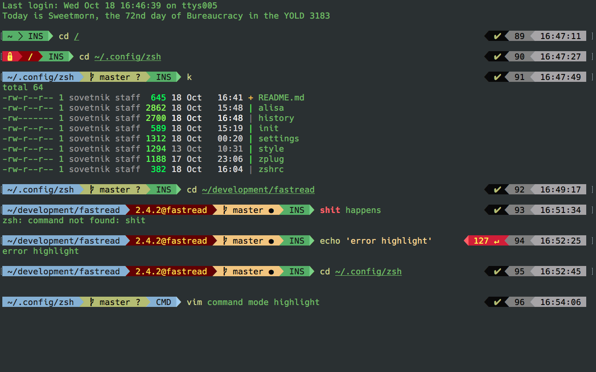

# ZSH configuration for vim + elixir workflow



## Installation

```sh
cd ~/.config
git clone git@github.com:sovetnik/zsh.git
ln -sf ~/.config/zsh/zshrc ~/.zshrc
```

Install base tools:

```sh
brew install ddate eza
```

Open a new shell (or run `source ~/.zshrc`).

## Plugins

Plugins are managed by **antidote**.
Bundled plugin list: `.zsh_plugins.txt`.
Generated bundle file: `.zsh_plugins.zsh`.

To update plugins manually:

```sh
antidote update
```

## Personal settings

Put machine-local secrets and overrides in ignored file `personal`
(e.g. tokens, local aliases, host-specific exports).
